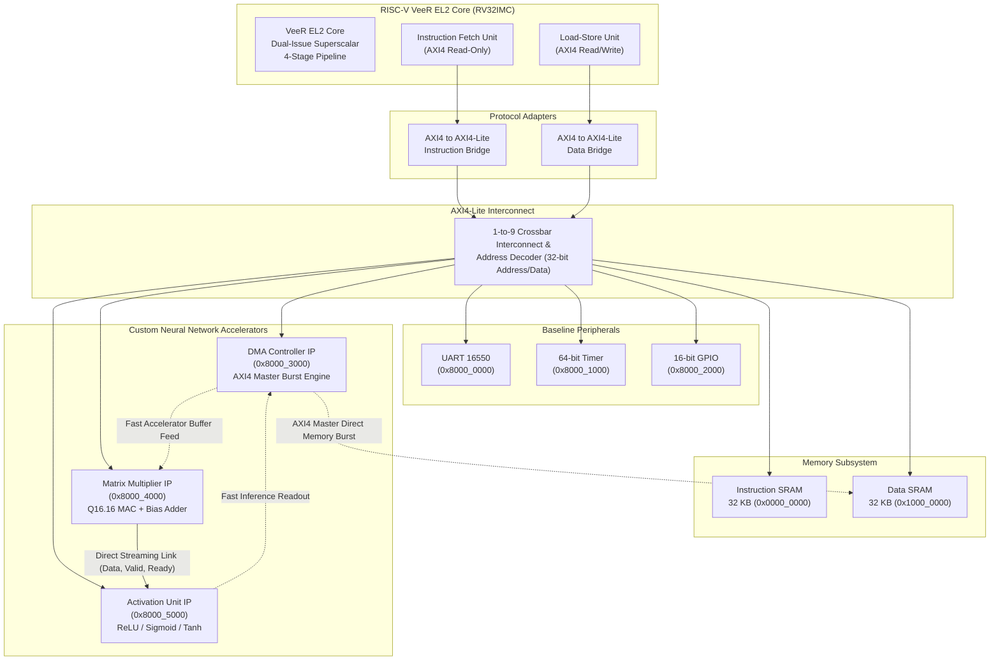
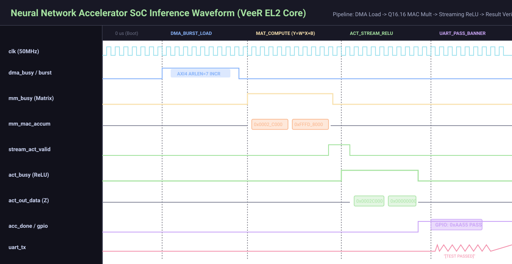
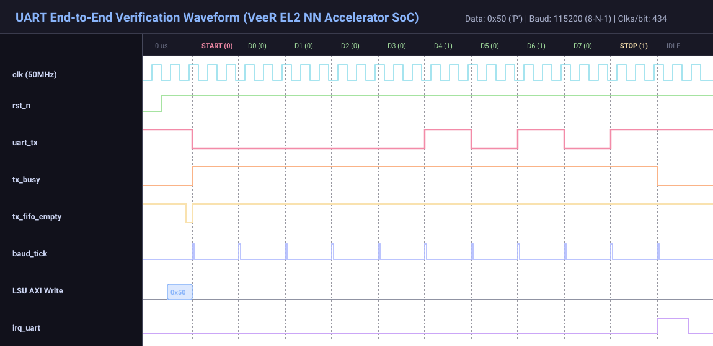

# RISC-V VeeR EL2 Based Neural Network Inference Acceleration SoC

[-red.svg)](https://github.com/chipsalliance/Cores-VeeR-EL2)
[]()
[]()
[]()
[](LICENSE)

An end-to-end, production-grade, synthesizable System-on-Chip (SoC) designed for **Lightweight Neural Network Inference Acceleration**, powered by the CHIPS Alliance **RISC-V VeeR EL2** superscalar core. The architecture features three tightly integrated custom hardware accelerators (**Matrix Multiplier IP**, **Activation Unit IP**, and **DMA Controller IP**), AXI4-to-AXI4-Lite bridges, a non-blocking crossbar interconnect, SRAM memory subsystems, standard industrial peripherals (UART, Timer, GPIO), and a complete **IEEE 1800.2 UVM 1.2 Verification IP (VIP)** testbench suite for Synopsys VCS and Verdi.

---

## Table of Contents

- [1. System Architecture](#1-system-architecture)
- [2. System Memory & Peripheral Address Map](#2-system-memory--peripheral-address-map)
- [3. Custom Hardware IPs](#3-custom-hardware-ips)
  - [3.1 Matrix Multiplier IP](#31-matrix-multiplier-ip)
  - [3.2 Activation Unit IP](#32-activation-unit-ip)
  - [3.3 DMA Controller IP](#33-dma-controller-ip)
- [4. Bus Architecture & Interconnect](#4-bus-architecture--interconnect)
- [5. Bare-Metal Firmware & Inference Pipeline](#5-bare-metal-firmware--inference-pipeline)
- [6. Verification & UVM VIP Environment](#6-verification--uvm-vip-environment)
- [7. Directory Structure](#7-directory-structure)
- [8. Simulation & Verification Guide (Synopsys VCS)](#8-simulation--verification-guide-synopsys-vcs)

---

## 1. System Architecture



---

## 2. System Memory & Peripheral Address Map

The memory map strictly follows 4 KB page alignment across all peripherals and memory blocks:

| Master / Slave Device | Base Address | End Address | Size | Description |
|---|---|---|---|---|
| **Instruction SRAM (IMEM)** | `0x0000_0000` | `0x0000_7FFF` | 32 KB | Dual-port instruction memory (Core fetch + LSU bootload) |
| **Data SRAM (DMEM)** | `0x1000_0000` | `0x1000_7FFF` | 32 KB | Data scratchpad memory & DMA source/destination buffer |
| **UART 16550** | `0x8000_0000` | `0x8000_0FFF` | 4 KB | Serial console communication (TX/RX FIFO, 115200 baud) |
| **64-bit Hardware Timer** | `0x8000_1000` | `0x8000_1FFF` | 4 KB | RISC-V MTIME / MTIMECMP real-time timer interrupt |
| **16-bit GPIO** | `0x8000_2000` | `0x8000_2FFF` | 4 KB | General Purpose I/O with directional and interrupt control |
| **DMA Controller IP** | `0x8000_3000` | `0x8000_3FFF` | 4 KB | AXI4 Master memory-to-accelerator burst engine |
| **Matrix Multiplier IP** | `0x8000_4000` | `0x8000_4FFF` | 4 KB | Q16.16 Fixed-Point Matrix-Vector Multiplier ($Y = W \times X + B$) |
| **Activation Unit IP** | `0x8000_5000` | `0x8000_5FFF` | 4 KB | Nonlinear Activation Functions (ReLU, Sigmoid PWL, Tanh PWL) |
| **Default Error Slave** | *Unmapped* | *Unmapped* | - | Returns AXI `DECERR` (2'b11) on illegal address decode |

---

## 3. Custom Hardware IPs

### 3.1 Matrix Multiplier IP (`rtl/ip/matrix_multiplier.sv`)
- **Mathematical Operation:** $\mathbf{Y} = \mathbf{W} \times \mathbf{X} + \mathbf{B}$
- **Numerical Format:** Signed Q16.16 Fixed-Point representation (1 sign bit, 15 integer bits, 16 fractional bits).
- **Submodules:**
  1. `mac_unit`: 32-bit $\times$ 32-bit signed multiplier yielding a 64-bit product, accumulated into a 64-bit register with automatic truncation and hardware saturation to $[ -2^{31}, 2^{31}-1 ]$.
  2. `input_buffer`: Dedicated 256-word SRAM storing input feature vector $\mathbf{X}$.
  3. `weight_buffer`: Dedicated 256-word SRAM storing weight matrix $\mathbf{W}$.
  4. `bias_adder`: Q16.16 signed adder with saturation logic for bias vector $\mathbf{B}$.
  5. `matrix_controller`: Multi-state FSM (`IDLE`, `LOAD`, `COMPUTE`, `ACCUM`, `BIAS_ADD`, `STREAM_OUT`, `DONE`).
  6. `output_buffer`: Stores final intermediate result vector $\mathbf{Y}$.
  7. `matrix_axi_regs`: AXI4-Lite slave configuration and status registers.
  8. Streaming Interface: Dedicated 32-bit streaming data/valid/ready port feeding the Activation Unit directly without bus contention.

### 3.2 Activation Unit IP (`rtl/ip/activation_unit.sv`)
- **Mathematical Functions:**
  - **ReLU:** $f(x) = \max(0, x)$
  - **Sigmoid PWL Approximation:** $f(x) \approx \frac{1}{1 + e^{-x}}$ evaluated using an ultra-low-latency 4-region piecewise linear approximation.
  - **Tanh PWL Approximation:** $f(x) \approx \tanh(x)$ evaluated via symmetric 4-region piecewise linear segments with zero floating-point overhead.
- **Handshake Protocol:** Fully decoupled valid/ready handshaking matching streaming and memory interfaces.
- **Status Reporting:** Busy, Done, and Overflow error flags with interrupt line generation.

### 3.3 DMA Controller IP (`rtl/ip/dma_controller.sv`)
- **Dual Bus Interface:**
  - **AXI4-Lite Slave:** Used exclusively by the RISC-V core for setting configuration registers (`SRC_ADDR`, `DST_ADDR`, `LEN`, `CMD`, `STATUS`).
  - **AXI4 Master Interface:** Real AXI4 burst master issuing read/write beats to transfer weight matrices, input feature vectors, and inference output buffers directly to/from Data SRAM (`0x1000_0000`).
- **Accelerator Direct Ports:** Fast buffer injection ports to Matrix Multiplier input/weight buffers and readout ports from the Activation Unit.

---

## 4. Bus Architecture & Interconnect

- **AXI4 to AXI4-Lite Bridges:**
  - `axi4_to_axi4lite.sv`: Converts VeeR EL2 LSU AXI4 64-bit/32-bit read/write burst transactions into single-beat AXI4-Lite transactions with proper ID tracking and backpressure handling.
  - `axi4_to_axi4lite_ro.sv`: High-efficiency read-only bridge dedicated to the Instruction Fetch Unit (IFU).
- **AXI4-Lite 1-to-9 Crossbar Interconnect:**
  - `axi4lite_interconnect.sv`: Single-cycle crossbar with non-blocking address decode and round-robin arbitration.
  - `axi4lite_decoder.sv`: Address decodes every 4 KB boundary and routes unmapped accesses to an error slave.
  - `axi4lite_assertions.sv`: Formal SVA assertions guaranteeing AXI4-Lite protocol adherence (handshake stability, no X/Z propagation, valid response codes).

---

## 5. Bare-Metal Firmware & Inference Pipeline

The software stack under `sw/` implements an automated end-to-end neural network inference pipeline:

1. **Boot Initialization (`crt0.S`):** Sets up the stack pointer (`_sp = 0x10007FF0`), clears BSS, and jumps to `main()`.
2. **UART Console Banner:** Prints initialization message at 115200 baud:
   ```
   [BOOT] RISC-V VeeR EL2 Neural Network SoC Initialized.
   [TEST] Starting Fixed-Point Q16.16 Inference Pipeline...
   ```
3. **Weight & Feature Preparation:** Preloads weight matrices $\mathbf{W}$ and input vector $\mathbf{X}$ into DMEM.
4. **DMA Transfer Kickoff:** Triggers DMA transfer from DMEM into the Matrix Multiplier hardware buffers.
5. **Matrix-Vector Multiplication:** Multiplier performs $Y = W \times X + B$ in Q16.16 signed fixed-point.
6. **Hardware Activation Execution:** Computed results stream into the Activation Unit to apply the selected activation function (e.g., ReLU).
7. **Result Verification:** Firmware reads the final output vector, compares with expected mathematical values, and outputs:
   ```
   [PASS] Neural Network Inference Acceleration Verified Successfully!
   ```

### 5.1 C Test Source Files & Software Artifacts
- **C Test Application:** [`sw/main.c`](sw/main.c) (Comprehensive inference application and IP test runner)
- **Pre-assembled Machine Code:** [`sw/main.hex`](sw/main.hex) (163 RV32IMC instructions pre-loaded into IMEM)
- **Disassembly Output:** [`sw/main.dis`](sw/main.dis) (Full assembly listing with addresses, opcodes, and labels)
- **IP Modular Drivers:**
  - Matrix Multiplier: [`sw/matrix_multiplier.h`](sw/matrix_multiplier.h), [`sw/matrix_multiplier.c`](sw/matrix_multiplier.c)
  - Activation Unit: [`sw/activation.h`](sw/activation.h), [`sw/activation.c`](sw/activation.c)
  - DMA Controller: [`sw/dma.h`](sw/dma.h), [`sw/dma.c`](sw/dma.c)
  - UART 16550: [`sw/uart.h`](sw/uart.h), [`sw/uart.c`](sw/uart.c)
  - Timer: [`sw/timer.h`](sw/timer.h), [`sw/timer.c`](sw/timer.c)
  - GPIO: [`sw/gpio.h`](sw/gpio.h), [`sw/gpio.c`](sw/gpio.c)
- **Linker & Assembly:** [`sw/link.ld`](sw/link.ld), [`sw/crt0.S`](sw/crt0.S), [`sw/Makefile`](sw/Makefile)

---

## 6. Visual Waveform Output Diagrams

### 6.1 End-to-End Neural Network Inference Acceleration Waveform
The diagram below illustrates the cycle-accurate execution sequence across the RISC-V VeeR EL2 core, DMA burst transfer, Matrix Multiplier MAC accumulation, streaming ReLU activation, and GPIO PASS assertion:



### 6.2 UART Transmission Waveform (115200 Baud, 8-N-1)
Cycle-accurate timing of the serial console output transmitting inference results to the external host:



---

## 6. Verification & UVM VIP Environment

The verification environment strictly follows the **IEEE 1800.2 UVM 1.2** methodology:

```
soc_uvm/
├── interfaces/             # SV Interface definitions for all IP VIPs
│   ├── soc_vip_interfaces.sv
│   ├── matrix_multiplier_if.sv
│   ├── activation_if.sv
│   ├── dma_if.sv
│   ├── uart_if.sv
│   ├── timer_if.sv
│   └── gpio_if.sv
├── soc_uvm_env/            # UVM Environment & Test Classes
│   ├── soc_config.sv
│   ├── soc_virtual_sequencer.sv
│   ├── soc_virtual_sequence.sv
│   ├── soc_env.sv
│   ├── soc_test.sv
│   ├── matrix_mult_test.sv
│   ├── activation_test.sv
│   ├── dma_test.sv
│   ├── uart_connectivity_test.sv
│   ├── timer_test.sv
│   └── gpio_test.sv
├── tb/                     # UVM Top Testbench
│   └── tb_soc_uvm_top.sv
└── sim/                    # Simulation scripts and filelist
    ├── filelist.f
    ├── Makefile
    ├── run_vcs.sh
    ├── view_wave_verdi.sh
    └── view_wave_dve.sh
```

### Standalone IP VIP UVM Testbenches (`tb/vip/`):
- `tb/vip/matrix_multiplier_vip_uvm_tb/`
- `tb/vip/activation_vip_uvm_tb/`
- `tb/vip/dma_vip_uvm_tb/`
- `tb/vip/uart_vip_uvm_tb/`
- `tb/vip/timer_vip_uvm_tb/`
- `tb/vip/gpio_vip_uvm_tb/`

### Testcase Matrix Classification (`docs/NN_Accelerator_SoC_Test_Cases.xlsx` & `docs/TEST_CASES.md`):
- **14 Internal Testcases (TC_INT_01 to TC_INT_14):** IP-level functional verification (MAC Q16.16 precision, signed saturation, bias adder, buffer auto-increment, ReLU/Sigmoid/Tanh accuracy, DMA burst lengths, address stride).
- **13 External Testcases (TC_EXT_01 to TC_EXT_13):** Full SoC integration verification (VeeR EL2 bootload, AXI4-Lite decoding, DMA-to-accelerator dataflow, end-to-end inference accuracy, UART/Timer/GPIO operation, interrupt handling).

---

## 7. Directory Structure

```
NN_Accelerator_SoC/
├── core_config/           # VeeR EL2 core configuration parameters and headers
│   ├── common_defines.vh
│   ├── defines.h
│   ├── el2_param.vh
│   ├── el2_pdef.vh
│   ├── pd_defines.vh
│   └── pic_map_auto.svh
├── docs/                  # Architectural documentation and testcase spreadsheets
│   ├── ADDRESS_MAP.md
│   ├── ARCHITECTURE.md
│   ├── NN_Accelerator_SoC_Test_Cases.xlsx
│   ├── REGISTER_MAP.md
│   ├── TEST_CASES.md
│   ├── UVM_VIP_GUIDE.md
│   └── VCS_USER_GUIDE.md
├── interfaces/            # Register and pin interface CSV specifications
│   ├── activation.csv
│   ├── dma.csv
│   ├── gpio.csv
│   ├── matrix_multiplier.csv
│   ├── timer.csv
│   └── uart.csv
├── rtl/                   # Synthesizable RTL source files
│   ├── bus/               # AXI4 / AXI4-Lite bridges and interconnect
│   ├── core/veer_el2/     # CHIPS Alliance VeeR EL2 core RTL
│   ├── ip/                # Custom accelerators (MM, Activation, DMA) & Peripherals
│   ├── mem/               # Dual-port and single-port SRAM models
│   └── soc_top.sv         # Top-level SoC integration wrapper
├── scripts/               # Automation scripts (Hex generation, test runners)
├── sim/                   # RTL unit testbenches and SoC simulation scripts
│   ├── filelist_soc.f
│   ├── filelist_unit.f
│   ├── Makefile.vcs
│   ├── run_vcs.sh
│   ├── view_wave_verdi.sh
│   └── view_wave_dve.sh
├── soc_uvm/               # Top-level SoC UVM 1.2 Verification Suite
│   ├── interfaces/
│   ├── sim/
│   ├── soc_uvm_env/
│   └── tb/
├── sw/                    # Bare-metal C drivers, linker script, crt0, main.hex
│   ├── crt0.S
│   ├── link.ld
│   ├── main.c
│   ├── main.hex
│   ├── Makefile
│   └── soc.h
└── tb/                    # Unit testbenches, models, and VIP components
    ├── models/
    ├── unit/
    └── vip/
```

---

## 8. Simulation & Verification Guide (Synopsys VCS)

### 8.1 Simulating Top-Level SoC with Bare-Metal Firmware

To compile and run the full SoC with VeeR EL2 executing the neural network inference firmware:

```bash
cd sim
# Execute full simulation flow
./run_vcs.sh

# Or using Makefile
make -f Makefile.vcs soc_top_run
```

To view simulation waveforms in **Synopsys Verdi**:
```bash
./view_wave_verdi.sh sim_soc.fsdb
```

To view waveforms in **Synopsys DVE**:
```bash
./view_wave_dve.sh sim_soc.vpd
```

---

### 8.2 Running SoC-Level UVM 1.2 Tests

Navigate to `soc_uvm/sim/` and invoke any of the UVM test targets:

```bash
cd soc_uvm/sim

# 1. Run Matrix Multiplier UVM Integration Test
make test_mm

# 2. Run Activation Unit UVM Integration Test
make test_act

# 3. Run DMA Controller UVM Integration Test
make test_dma

# 4. Run UART Connectivity UVM Test
make test_uart

# 5. Run Timer Interrupt UVM Test
make test_timer

# 6. Run GPIO Loopback UVM Test
make test_gpio
```

To run a specific test with a custom random seed:
```bash
./run_vcs.sh matrix_mult_test 42
```

To inspect FSDB waveforms in Verdi:
```bash
./view_wave_verdi.sh sim_soc_uvm.fsdb
```

---

### 8.3 Running Standalone Custom IP Unit Testbenches

```bash
cd sim

# Verify Custom IP 1 (Matrix Multiplier)
make -f Makefile.vcs test_matrix_mult

# Verify Custom IP 2 (Activation Unit)
make -f Makefile.vcs test_activation

# Verify Custom IP 3 (DMA Controller)
make -f Makefile.vcs test_dma

# Verify Bus Interconnect & AXI4 Bridges
make -f Makefile.vcs test_interconnect
make -f Makefile.vcs test_axi_bridge
```

---

## Authors & Acknowledgments

- **Project Title:** RISC-V Based SoC for Lightweight Neural Network Inference Acceleration
- **Reference Repository:** [RISC-V VeeR EL2 Based Sensor Monitoring and Signal Processing SoC](https://github.com/AkshaySai06/RISC-V-VeeR-EL2-Based-Sensor-Monitoring-and-Signal-Processing-SoC)
- **Core IP:** CHIPS Alliance VeeR EL2 Core (Apache 2.0 License)
